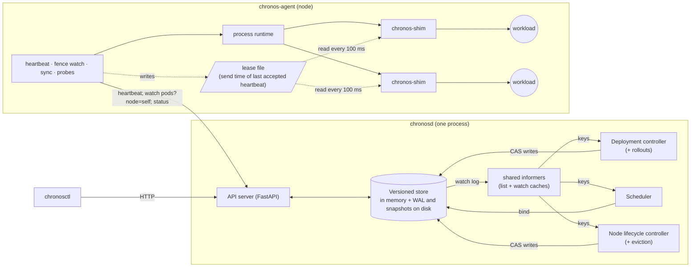
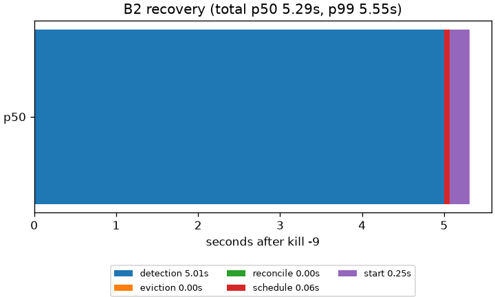
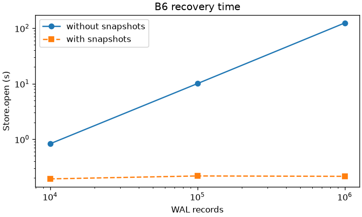

<h1 align="center">Chronos</h1>

A small container orchestrator in the spirit of Kubernetes, built from scratch in Python: declarative desired state, a versioned store with compare-and-swap and a write-ahead log, a filter/score scheduler, watches and informers, heartbeats and failure detection, self-fencing nodes, rolling updates and probes. Workloads are real OS processes. Every guarantee here is backed by three things: a property or real-process test that states it, a deterministic simulator that checks it after every event of thousands of seeded fault schedules, and a mutation check showing that test fails when the code that upholds the guarantee is broken.

<p align="center">
  <a href="#features">Features</a> ·
  <a href="#system-architecture">Architecture</a> ·
  <a href="#engineering-decisions-that-mattered">Engineering Decisions</a> ·
  <a href="#what-is-guaranteed-and-how-its-tested">Guarantees</a> ·
  <a href="#benchmarks">Benchmarks</a> ·
  <a href="#build-and-run">Build & Run</a>
</p>

## Features

*   **Declarative deployments.** `chronosctl apply -f web.yaml`; a level-triggered controller converges the cluster to it and keeps it there.
*   **A filter/score scheduler** over CPU, memory and **extended resources** (`chronos.dev/slot`, or any name): integer, non-shareable, a **hard** constraint. A pod that needs a slot waits rather than land on a node without one. Spread (`LeastAllocated`) or pack (`MostAllocated`); plugins register by name.
*   **Failure detection and rescheduling.** Nodes heartbeat; a silent node goes Unknown, then NotReady, and its pods are replaced elsewhere.
*   **Self-fencing.** Every workload runs under a small shim that stops it once its node has lost contact with the control plane for too long, even if the node's agent is dead. A paused, crashed or partitioned node can't leave a duplicate replica running.
*   **Durable before acknowledged.** Every write is CRC-framed in a write-ahead log and synced (`F_FULLFSYNC` on macOS) before anyone hears back; snapshots bound recovery to ~0.2 s; optional group commit for ~10× write throughput under load.
*   **Watches, informers, a work queue, expectations and an assume cache**, the client-go machinery, instead of polling.
*   **Rolling updates** under `max_surge` / `max_unavailable`; **readiness and liveness probes** (exec, HTTP, TCP); **memory limits** (killed as `OOMKilled`); **cordon and drain**.
*   **Observability:** events (`chronosctl describe` says why a pod is Pending), JSON logs with trace ids, 14 Prometheus metrics and a provisioned Grafana dashboard.
*   **Extension seams** for new resources, scheduler plugins, workload types, resource providers, kinds and controllers, each a registry of a protocol, proven by test-only extensions that run end to end with no production changes.
*   **590 tests:** unit, Hypothesis property and stateful tests, a client contract suite run against both clients, real-process integration, crash-point durability, a deterministic simulator with 11 canary bugs, and chaos on real processes.

## System Architecture

One control-plane process (`chronosd`) holds the only state. Agents, one per "node", **pull**: the control plane never connects to them. Everything that decides something (scheduling, reconciliation, rollouts, node health, what an agent should run) is a **pure function** in `src/chronos/core/`, with no I/O and no clock, wrapped by thin loops. That is what makes the property tests and the simulator possible: the same functions run under real time, random inputs and virtual time.



*   **One store holds the truth.** Every write bumps a global revision and is a compare-and-swap on the object's `resource_version`, so a stale writer gets `409 Conflict` instead of silently overwriting ([ADR-0007](docs/adr/0007-versioned-single-writer-store.md)). Binding a pod re-checks capacity inside the same transaction.
*   **Level-triggered, on watches.** An informer keeps a local cache from a long-poll watch and turns each change into a key on a deduplicating queue; `reconcile(key)` recomputes the whole diff. A client too far behind gets `410 Gone` and relists ([ADR-0008](docs/adr/0008-watch-via-long-polling.md), [ADR-0009](docs/adr/0009-level-triggered-reconciliation.md)).
*   **Self-fencing timings are checked at startup:** fence timeout F + kill grace K + clock drift < eviction timeout E, or nothing starts ([ADR-0012](docs/adr/0012-agent-self-fencing.md)).

## Tech Stack

| Layer | Choice |
| :--- | :--- |
| Language | Python 3.12, `mypy --strict`, ruff |
| API and models | FastAPI, Pydantic v2, httpx; HTTP + JSON with long-poll watches ([ADR-0004](docs/adr/0004-http-json-transport.md)) |
| CLI | Typer (`chronosctl`, `chronosd`, `chronos-agent`) |
| Workloads | OS processes in their own process groups, each under `chronos-shim`; psutil ([ADR-0005](docs/adr/0005-workloads-are-os-processes.md)) |
| Durability | own write-ahead log (CRC framing, segment rotation, snapshots, `F_FULLFSYNC`) ([ADR-0015](docs/adr/0015-wal-and-snapshots.md)) |
| Testing | pytest, Hypothesis (property + stateful), a deterministic simulator, a chaos harness with a TCP fault proxy |
| Observability | Prometheus client, Grafana (pinned, provisioned via docker compose) ([ADR-0024](docs/adr/0024-prometheus-grafana-observability.md)) |
| Tooling | uv, pre-commit ([ADR-0003](docs/adr/0003-tooling.md)) |
| CI | GitHub Actions on Ubuntu and macOS: lint + types, unit + property, 200 simulator seeds with every canary, observability smoke, 60 s of chaos, benchmark smoke; nightly 10 000 seeds, 20 000-example properties, 3 × 10 min of chaos |

## Engineering Decisions That Mattered

Five of the [24 architecture decisions](docs/adr/README.md), each with what was measured or tested, not just argued for.

### 1. Nodes Fence Themselves, Timed From When the Heartbeat Was Sent

**Problem**: When a node goes silent, the control plane can't tell a dead node from a partitioned or paused one. If it starts replacements while the "dead" node's workloads still run, a deployment of R replicas briefly has more than R, which is unacceptable for anything that writes.

**Approach**: Every workload runs under a `chronos-shim` that reads the agent's lease file every 100 ms. Once no heartbeat has been accepted for F, measured from the heartbeat's **send** time, not the reply, the agent and every shim stop their workloads within K, even if the agent itself is dead. The control plane only replaces pods after E, and both sides refuse to start unless F + K + drift < E.

**Result**: Integration tests sample live process groups every 20 ms under agent pause, agent crash and network partition, and never see more than R. The simulator's canaries confirm that each piece is needed: turning off fencing, fencing only in the agent, setting F > E, or timing the lease from the reply each produce duplicates within a few seeds. Chaos on real processes found a metastable failure in the heartbeat timeout (an overloaded control plane caused fencing storms that kept it overloaded), fixed by waiting up to F/2 for a reply, which is safe *because* the lease counts from send time.

**Tradeoff**: A control-plane outage longer than F stops every workload. Kubernetes keeps pods running instead; Chronos chooses no duplicates over availability. The real fix is control-plane HA, out of scope here. See [ADR-0012](docs/adr/0012-agent-self-fencing.md).

### 2. Durable Before Visible, and Measuring What a Sync Really Costs

**Problem**: An orchestrator that loses an acknowledged write after a crash can re-create or lose pods.

**Approach**: Each write is one CRC-framed WAL record, synced before memory changes and before the client hears back; snapshots bound replay. A crash-point harness kills the store at 7 points × 50 seeds and compares what recovery returns with a reference run; properties recover from every truncation offset and from bit flips.

**Result**: Benchmark B5 found that macOS's plain `fsync` is nearly free because it only reaches the drive's cache, so the WAL uses `F_FULLFSYNC`: about **300 durable writes/s**. Group commit (`--wal-sync group`) shares one sync among concurrent writers: **3 393 writes/s** with 32 writers, the no-sync ceiling. Snapshots cut recovery of 1M records from **124 s to 0.22 s**. The `ack_before_fsync` canary proves the simulator's simulated disk, which keeps only synced bytes across a crash, catches the bug.

**Tradeoff**: The sync blocks `chronosd`'s event loop. Under heavy write load that delays heartbeats; chaos found the consequence, and moving the sync off the loop is the fix to make if write rates grow. See [ADR-0015](docs/adr/0015-wal-and-snapshots.md) and [BENCHMARKS.md](docs/BENCHMARKS.md#b5-what-the-wal-costs).

### 3. Simulate the Real Code, Not a Model of It

**Problem**: The bugs that matter in an orchestrator are interleavings: a pause at the wrong moment, a reply that arrives after a relist. Real-process tests hit them rarely and can't replay them.

**Approach**: A deterministic simulator runs the **real** store (WAL and recovery included), controllers and agent under virtual time and one seeded RNG, with simulated network, disk and processes. Seeded schedules inject crashes, pauses, whole-node freezes, partitions, delay spikes, drops, crash storms, failing probes and rolling updates; every safety invariant is checked after every event. Eleven **canary bugs** (one protection switched off each) must each be detected.

**Result**: Its first runs found three real bugs: after a whole-node freeze the agent renewed its lease before the shim's next poll (a replaced workload ran alongside its replacement); a resumed agent restarted evicted pods from a stale cache; and a concurrent relist wiped a pod a watch had delivered. All three are fixed and replayed on every PR. Any failure replays exactly from its seed, and `--minimize` shrinks its schedule.

**Tradeoff**: The simulator drives the agent's logic, not its asyncio shell or real processes. A chaos harness covers that gap by checking the same invariants on real processes through a TCP fault proxy. See [ADR-0016](docs/adr/0016-deterministic-simulation-testing.md).

### 4. Caches Make Controllers Fast, and Wrong Without Expectations

**Problem**: Replacing polling with watches and informer caches means every controller acts on state that lags the store. A deployment controller that hasn't seen its own creates yet creates them again; a scheduler that hasn't seen its own binds double-books a node.

**Approach**: The deployment controller records **expectations** (how many pods it is creating, which it is deleting) and doesn't act on a key until its cache has caught up; the scheduler keeps an **assume cache** of its own binds; the store re-checks capacity at bind regardless.

**Result**: The `disable_expectations` and `skip_bind_capacity_check` canaries are caught as duplicate replicas and overcommit. Benchmark B4 then found that **85% of scheduling time was deep-copying every cached node** on every decision; a read-only view for that hot path made the scheduler **2.8-3.9× faster** (221 pods/s at 100 nodes).

**Tradeoff**: More moving parts than a polling loop, each with its own failure mode, which is why each one has a canary. See [ADR-0009](docs/adr/0009-level-triggered-reconciliation.md).

### 5. Testing the Tests

**Problem**: A green test proves something only if it would fail when the guarantee breaks.

**Approach**: For every guarantee, break the code that upholds it with a one-line, marked mutation, run the tests that should catch it, and record the result, including the failures, in [`docs/testing-the-tests.md`](docs/testing-the-tests.md).

**Result**: Of **67** mutations, 54 were caught on the first try; **13 survived**, and each led to a new or redesigned test. Two examples: a test of upgrade compatibility that could never fail because both sides of its comparison came from the same code (now pinned to a value from the previous version), and an extension seam test whose test-only controller didn't own pods, which hid a bug that would have deleted every Stage 2 Job's pods (found, fixed, now tested).

**Tradeoff**: Curated by hand, not exhaustive like a mutation-testing tool; the canaries re-check the most important protections on every PR.

## What Is Guaranteed, and How It's Tested

Safety invariants (S) and liveness properties (L). Every safety row is also checked by the [simulator](tests/sim/test_sim.py) after every event of every seed, and the liveness rows once each run goes quiet.

| | Invariant | Evidence |
| :--- | :--- | :--- |
| **S1** | a pod is bound to at most one node, once | [store tests](tests/unit/test_store.py), [stateful model](tests/property/test_store_model.py) |
| **S2** | for every resource name, Σ requests ≤ capacity on every node | [scheduler properties](tests/property/test_schedule_props.py), [bind property](tests/property/test_store_bind_props.py), [integration](tests/integration/test_scheduling.py) |
| **S3** | at most R live processes per deployment, under agent pause, agent crash and partition | [process groups sampled every 20 ms](tests/integration/test_fencing.py), [restart](tests/integration/test_orphans.py), [node loss](tests/integration/test_deployments.py) |
| **S4** | a cut-off node's workloads stop within F + K | [fencing](tests/integration/test_fencing.py), [shim](tests/integration/test_shim.py), [boundaries](tests/unit/test_fencing.py), [send-time rule](tests/unit/test_agent_fencing.py) |
| **S5** | revisions strictly increase; a stale compare-and-swap never succeeds | [stateful model](tests/property/test_store_model.py) |
| **S6** | a watch delivers every change after its revision, in order, or fails with `410 Gone` | [replay properties](tests/property/test_watch_props.py), [both clients](tests/contract/test_store_client.py), [informer relists](tests/unit/test_runtime.py) |
| **S7** | a rolling update runs at most `replicas + max_surge` pods and never voluntarily takes ready pods below `replicas - max_unavailable` | [rollout properties](tests/property/test_rollout_props.py), [real processes](tests/integration/test_tier2.py) |
| **S8** | an acknowledged write survives a crash; nothing half-written is applied | [7 crash points × 50 seeds](tests/durability/test_crash_recovery.py), [WAL properties](tests/property/test_wal_props.py) |
| **S11** | extended resources are a hard constraint | [scheduler properties](tests/property/test_schedule_props.py), [bind property](tests/property/test_store_bind_props.py), [demo scenario](tests/integration/test_demo_scenario.py) |
| **S12** | no unit of an extended resource is held by two live pods | [provider property](tests/property/test_providers_props.py), [integration](tests/integration/test_scheduling.py) |
| **L1** | a dead node is detected within the configured windows | [boundary table](tests/unit/test_node_health.py), [lifecycle](tests/unit/test_node_lifecycle.py) |
| **L2** | deployments converge to their replica count and template | [reconcile properties](tests/property/test_reconcile_props.py), [rollout properties](tests/property/test_rollout_props.py) |
| **L3** | a pending pod that fits somewhere gets placed | [scheduler properties](tests/property/test_schedule_props.py) |
| **L4** | the cluster reconverges after a control-plane restart | [restart tests](tests/integration/test_control_plane_restart.py) |
| **L5** | no process left behind after delete or teardown | [integration](tests/integration/test_deployments.py); every integration test fails on a leaked process |

**The layers:**

*   **Unit and property tests** (Hypothesis; 100 examples locally, 1 000 in CI, 20 000 nightly) over the pure core: random clusters with random resource names, random rollouts, a stateful model of the store.
*   **A contract suite** run against both the in-process and HTTP clients.
*   **Real-process integration tests:** a real `chronosd` and agents as subprocesses, killed, paused and partitioned.
*   **Durability:** crash at every crash point, recover, compare.
*   **The deterministic simulator** (`python -m chronos.sim --seed N`): 200 seeds per PR, 10 000 nightly, 11 canaries.
*   **Chaos on real processes** (`python -m chronos.testing.chaos --seed N`): kill -9 of agents, nodes and `chronosd`, SIGSTOP of agents and whole nodes, delay / drop / blackhole / reset through a TCP fault proxy, crash storms and failing probes, while a live checker samples the store and the OS process table every 200 ms.
*   **Modularity proof:** a resource, a scheduler plugin, a workload type and a resource provider that exist only in [test code](tests/extensions.py) pass the scheduling and bind properties, run a real process, and hold every invariant in the simulator, where a deliberately broken test provider is caught. A test-only kind and controller get the API, watch, WAL and a reconcile loop.

## Benchmarks

Six questions, each answered with raw samples and percentiles, never a single mean. **Environment:** Apple M2, 8 cores, 16 GiB, macOS 26, Python 3.12, one run each with ordinary background load: the shapes and orders of magnitude are the point, not the third digit. Full methodology and interpretation: [docs/BENCHMARKS.md](docs/BENCHMARKS.md).

| | Question | Result |
| :--- | :--- | :--- |
| **B1** | `apply` to all replicas Running | 1 replica: **53 ms** p50; 10: 1.3 s; 100: 15.6 s |
| **B2** | node death to replacements Running | **5.29 s** p50, of which 5.0 s is detection, by design |
| **B3** | detection speed vs false evictions | E = 3 s: detected in 3.2 s, **10%** of pauses falsely evicted; E = 6 s: 6.2 s, **0%** |
| **B4** | scheduler throughput | **221 pods/s** at 100 nodes (decision p50 3.6 ms); 33 pods/s at 1 000 |
| **B5** | the WAL's cost | durable: **300 writes/s**; group commit, 32 writers: **3 393/s** |
| **B6** | recovery time vs WAL size | 1M records: **124 s** without snapshots, **0.22 s** with |

<p align="center"> </p>

## Bottlenecks

What still limits Chronos, as measured:

*   **Process start-up dominates large rollouts.** At 100 replicas, B1 measures 100 Python interpreters (shim plus workload) starting at once on the same 8 cores as the control plane and agents, not the control plane itself.
*   **The WAL sync blocks the event loop.** About 3 ms per durable write on this Mac, during which `chronosd` does nothing else. Group commit amortises it; moving it off the loop is the next step.
*   **Scheduling is linear in nodes.** Every node is filtered and scored for every pod; at 1 000 nodes that's 33 pods/s. Kubernetes samples a subset of feasible nodes; Chronos doesn't yet.
*   **One machine.** All "nodes" share one CPU, disk and clock, with no network between them, and the numbers above were taken under ordinary background load.

## Limitations & Non-Goals

These are scope boundaries and deliberate trade-offs, not oversights.

*   **A control-plane outage longer than the fence timeout stops every workload.** Agents can't tell a dead control plane from a partition, so they fence: safety over availability (see decision 1).
*   **"No duplicate replicas" is scoped to agent pause, agent crash and network partition.** After a whole-node freeze (a VM pause that stops the shims too), a stale workload can run for at most one shim poll (100 ms) alongside its replacement; Kubernetes has the same limit. This assumes the node's monotonic clock keeps advancing across the freeze, which holds on one host.
*   **Single machine, single control plane.** Nodes are processes on one host; there is no control-plane HA.
*   **Little resource isolation.** Requests are placement accounting. Memory limits are enforced by polling resident memory every 0.5 s, not by a cgroup, so a fast allocation can overshoot for one interval; CPU is advisory.
*   **Long-running deployments only.** No run-to-completion jobs yet.
*   **No GPU support yet.** Planned as Stage 2, on the extension seams: a GPU is an extended resource, a CUDA task is a workload type, device assignment is a resource provider.
*   **No auth, TLS or multi-tenancy.** Built for a trusted localhost.
*   **Extensions are registered in-process.** No plugin loader.

## Code Quality

*   **A functional core.** Scheduling, reconciliation, rollouts, probes, node health and agent sync are pure functions; an [architecture test](tests/unit/test_architecture.py) fails the build if `core/` imports anything for I/O, asyncio, clocks or randomness.
*   **`mypy --strict` and ruff**, blocking in CI and in pre-commit.
*   **An injectable clock everywhere**, so timing logic is tested on a fake clock and the simulator runs it on virtual time.
*   **Every integration test fails if a workload process outlives its cluster.**
*   **Linux and macOS** in CI; three bugs were found only on Linux (`ps` truncating command lines, zombie process groups, AppleDouble files).

## Build and Run

Needs [uv](https://docs.astral.sh/uv/) and macOS or Linux.

```bash
uv sync                      # Python 3.12 and locked dependencies
make check                   # ruff, mypy --strict and the test suite
make demo-cluster            # chronosd on :7070 + agents plain-1, slot-a, slot-b
```

In a second terminal:

```bash
uv run chronosctl get nodes
uv run chronosctl apply -f examples/web.yaml
uv run chronosctl get pods -o wide
```

```bash
make observability           # Prometheus + Grafana (Docker); dashboard on http://localhost:3000
make test-durability         # crash-point recovery suite
uv run python -m chronos.sim --seeds 0:200          # the simulator; --canary NAME, --minimize
uv run python -m chronos.testing.chaos --seed 1     # chaos on real processes (60 s)
make bench                   # B1-B6 (about an hour)
```

**`chronosctl`:**

| Command | What it does |
| :--- | :--- |
| `apply -f FILE` | create or update (compare-and-swap); a template change rolls out under `max_surge` / `max_unavailable` |
| `get KIND [NAME] [-o table\|wide\|yaml\|json] [--watch]` | nodes, pods, deployments, events, or any registered kind |
| `describe KIND NAME` | the object plus its events, e.g. why a pod is Pending |
| `logs POD [--stderr]` | a workload's output |
| `scale deployment NAME --replicas N`, `delete KIND NAME` | |
| `cordon NODE`, `uncordon NODE`, `drain NODE` | stop placements on a node; drain also moves its pods off |

**The demo** (`plain-1` has no slots; `slot-a` and `slot-b` advertise `chronos.dev/slot=1` each):

| Step | Run | What happens |
| :--- | :--- | :--- |
| 1 | `chronosctl apply -f examples/web.yaml` | 3 `web` pods go Pending → Bound → Running, spread over the nodes, each a real PID |
| 2 | `chronosctl apply -f examples/slot-demo.yaml` | 2 slot pods run on `slot-a` and `slot-b`; the 3rd stays Pending: `0/3 nodes available: Insufficient chronos.dev/slot` |
| 3 | `scripts/kill-node.sh slot-a` | `slot-a` → Unknown → NotReady; `web` is replaced elsewhere; the slot pod's replacement **waits** rather than land on `plain-1` |
| 4 | `scripts/start-agent.sh slot-a --resource chronos.dev/slot=1` | `slot-a` is Ready again and the waiting pod takes its slot |
| 5 | `chronosctl get events` | the story so far: Scheduled, Started, FailedScheduling, NodeNotReady, Evicted, ... |

The same scenario runs as an automated test ([`test_demo_scenario.py`](tests/integration/test_demo_scenario.py)), and against a fresh clone with `scripts/fresh-clone-check.sh`.

## Project Structure

```
src/chronos/
├── api/          # Pydantic models, the resource map, quantities, workload-type registry
├── core/         # pure logic: schedule, reconcile, rollout, probes, node_health, agent_sync, fencing
├── store/        # versioned store, WAL + snapshots + recovery, watch log, kind registry
├── server/       # FastAPI app and the chronosd entry point
├── controllers/  # runtime (informers, work queue, expectations), deployment, scheduler, node lifecycle
├── client/       # StoreClient protocol; in-process and HTTP clients
├── agent/        # chronos-agent: process runtime, probes, resource providers
├── shim/         # chronos-shim: the per-pod wrapper that enforces fencing
├── sim/          # deterministic simulator: engine, network, disk, faults, invariants, canaries
├── cli/          # chronosctl
└── testing/      # test workload, real-cluster fixture, fault proxy, chaos harness

tests/            # unit, property, contract, integration, durability, sim, chaos
bench/            # B1-B6 and their raw results
deploy/           # Prometheus + Grafana (docker compose, provisioning, the dashboard)
examples/         # manifests for the demo
docs/             # ADRs, benchmarks, the mutation-testing log, the devlog
```

## Documentation

*   [Architecture Decision Records](docs/adr/README.md): 24 decisions, each with its context, alternatives and consequences
*   [Benchmarks](docs/BENCHMARKS.md): methodology, raw samples, plots and interpretation
*   [Testing the tests](docs/testing-the-tests.md): every mutation check, the ones that survived, and the real bugs the tests found
*   [Devlog](docs/devlog/): what was built each day, and what broke
