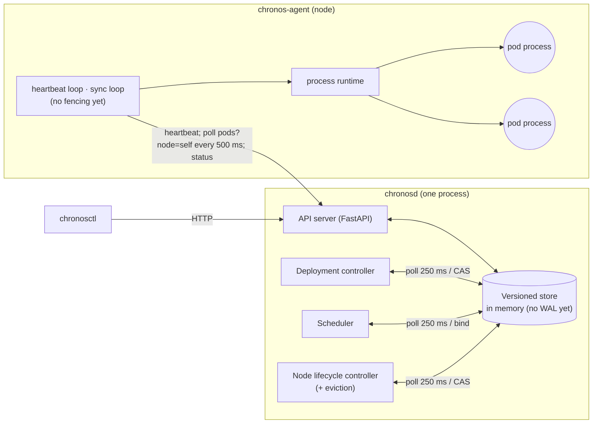

# Chronos

A small container orchestrator, in the spirit of Kubernetes, built from scratch in Python to
learn and demonstrate how orchestration works: declarative desired state, a versioned store
with compare-and-swap, a filter/score scheduler, node heartbeats and failure detection, and
level-triggered reconciliation. Workloads are real OS processes.

> You declare desired state in YAML. Chronos places each replica on a node that fits its CPU,
> memory and extended-resource requests (an extended resource such as `chronos.dev/slot` is an
> integer, non-shareable, **hard** constraint), runs it as a real OS process, and when a node
> dies it detects the failure and reschedules the work. It never places a workload on a node
> that doesn't advertise enough free units of a requested extended resource, even when that
> means the workload waits. Every one of those statements is backed by a property-based or
> real-process test.

**Status: `v0.1-mvp`.** The core loop works end to end and is tested; the
[limitations](#limitations-what-v01-mvp-does-not-do-yet) are listed below, each with the block
that fixes it.

## Quickstart

Needs [uv](https://docs.astral.sh/uv/) and macOS or Linux.

```bash
uv sync                      # Python 3.12 + dependencies from uv.lock
make check                   # ruff, mypy --strict, ~300 tests (unit, property, real-process)
make demo-cluster            # chronosd on :7070 + agents plain-1, slot-a, slot-b
```

In a second terminal:

```bash
uv run chronosctl get nodes
uv run chronosctl apply -f examples/web.yaml
uv run chronosctl get pods -o wide
```

## Demo

`plain-1` has no slots; `slot-a` and `slot-b` advertise `chronos.dev/slot=1` each. Demo
timings: heartbeat 0.5 s, Unknown after 2 s of silence, NotReady (and eviction) after 5 s.

| Step | Run | What happens |
|------|-----|--------------|
| 1 | `chronosctl get nodes` | 3 nodes `Ready`; the slot column reads `—`, `0/1`, `0/1` |
| 2 | `chronosctl apply -f examples/web.yaml` | 3 `web` pods go Pending → Bound → Running, spread over the nodes, each with a real PID |
| 3 | `ps -o pid,pgid,command -p <pid>` | a real process, in its own process group |
| 4 | `chronosctl scale deployment web --replicas 5` | 2 more pods converge |
| 5 | `chronosctl apply -f examples/slot-demo.yaml` | 2 slot pods run on `slot-a` and `slot-b`; the 3rd stays Pending: `0/3 nodes available: Insufficient chronos.dev/slot (3/3 nodes)` |
| 6 | `chronosctl scale deployment slot-demo --replicas 2` | the Pending pod is the one removed |
| 7 | `scripts/kill-node.sh slot-a` | `slot-a` → Unknown → NotReady; its pods → `Failed/NodeLost`; `web` is replaced elsewhere; the slot pod's replacement **waits** instead of landing on `plain-1` |
| 8 | `scripts/start-agent.sh slot-a --resource chronos.dev/slot=1` | `slot-a` is Ready again and the waiting pod takes its slot |

The same scenario runs as an automated test,
[`test_demo_scenario.py`](tests/integration/test_demo_scenario.py), and unattended against a
fresh copy of the repo with `scripts/fresh-clone-check.sh`.

## Architecture (as built in `v0.1-mvp`)



- **One store holds the truth.** Every write bumps a global revision and is a compare-and-swap
  on the object's `resource_version`, so a stale writer gets `409 Conflict` instead of
  silently overwriting ([ADR-0007](docs/adr/0007-versioned-single-writer-store.md)).
- **Functional core, imperative shell.** Scheduling, reconciliation, node health and agent
  sync are pure functions in `src/chronos/core/` with no I/O or clock access; the loops around
  them are thin ([ADR-0006](docs/adr/0006-functional-core-imperative-shell.md)). That is what
  makes the property tests below possible.
- **Level-triggered.** Every tick recomputes the full diff from authoritative state, so
  nothing depends on having seen a particular event.
- **Agents pull.** The control plane never connects to an agent.

**Deliberate MVP shortcuts** ([ADR-0022](docs/adr/0022-week-1-mvp-scope.md)): controllers poll
the store instead of watching it; no fencing shim (the fault model is crash-stop of a whole
node); state is in memory only; one-phase deletion; crashed workloads are replaced rather
than restarted in place. Each one has a scheduled fix, listed under Limitations.

## What is guaranteed, and how it's tested

| Invariant | Status | Evidence |
|-----------|--------|----------|
| **S1** a pod is bound to at most one node, once | ✅ | [store unit tests](tests/unit/test_store.py), [stateful model test](tests/property/test_store_model.py) |
| **S2** for every resource name, Σ requests ≤ capacity on every node | ✅ | [scheduler properties](tests/property/test_schedule_props.py), [bind property](tests/property/test_store_bind_props.py), [integration](tests/integration/test_scheduling.py) |
| **S3** at most R live processes per deployment | ⚠️ crash-stop only | [integration: live processes sampled every 20 ms during node-loss recovery](tests/integration/test_deployments.py). Not guaranteed under partition, pause or agent-only crash (no fencing yet). |
| **S5** revisions strictly increase; a stale compare-and-swap never succeeds | ✅ | [stateful model test](tests/property/test_store_model.py) |
| **S11** extended resources are a hard constraint, never a soft preference | ✅ | [scheduler properties](tests/property/test_schedule_props.py), [bind property](tests/property/test_store_bind_props.py), [integration](tests/integration/test_scheduling.py), [demo scenario](tests/integration/test_demo_scenario.py) |
| **L1** a dead node is detected within the configured windows | ✅ | [boundary table](tests/unit/test_node_health.py), [lifecycle on a fake clock](tests/unit/test_node_lifecycle.py), [integration](tests/integration/test_agent.py) |
| **L2** deployments converge to their replica count | ✅ | [reconcile properties](tests/property/test_reconcile_props.py), [integration](tests/integration/test_deployments.py) |
| **L3** a pending pod that fits somewhere gets placed | ✅ | [scheduler properties](tests/property/test_schedule_props.py), [demo scenario, step 8](tests/integration/test_demo_scenario.py) |
| **L5** no processes left behind after delete or teardown | ✅ | [integration](tests/integration/test_deployments.py); every integration test fails if a pod process outlives its cluster ([fixture](tests/integration/conftest.py)) |
| **S4, S6, S7, S8, S12, L4** | ❌ not yet | fencing, watch, rollouts, durability, resource providers: see Limitations |

**Modularity:** a resource that exists only in test code, `example.com/widget`, plus a
test-only scheduler plugin, pass the scheduling and bind properties with no production-code
changes ([`test_modularity_widget.py`](tests/property/test_modularity_widget.py)).

**How the tests are layered:** unit tests, Hypothesis property and stateful tests (100 examples
locally, 1 000 in CI, 20 000 with `make test-nightly`), and integration tests that run a real
`chronosd` and agents as subprocesses. CI runs everything on Ubuntu and macOS.

## Limitations: what `v0.1-mvp` does not do yet

> **Chronos v0.1-mvp: what this does NOT do yet.** Each item names the planned fix.

1. **No durability.** All cluster state is in memory. Restarting `chronosd` loses every Deployment, Pod and Node. Agents re-register, find no desired state, and stop their workloads. → WAL + snapshots, PM-2 ([ADR-0015](docs/adr/0015-wal-and-snapshots.md)).
2. **No fencing; duplicates are possible outside the crash-stop model.** If a node is *partitioned or paused* (e.g. `SIGSTOP` on the agent), or **only the agent process** crashes, its workloads keep running while the control plane starts replacements. "At most R replicas" (S3) holds **only when the whole node dies** (the scenario in the demo), and is not guaranteed otherwise. → agent + `chronos-shim` self-fencing, PM-1 ([ADR-0012](docs/adr/0012-agent-self-fencing.md)).
3. **No chaos testing or deterministic simulation.** Fault testing is limited to scripted integration tests (whole-node kill). There are no randomized fault schedules, network partitions, delays or message loss, and no canary bugs proving test strength. → PM-4 (simulator), PM-6 (chaos harness).
4. **No GPU/CUDA support: planned, Stage 2 (deferred).** Nothing detects or uses GPUs, and no CUDA runs. Stage 1 provides the seams GPU support plugs into: extended resources (X-1/X-2), workload types (X-4) and resource providers (X-5), proven in-process by PX.9 ([`test_modularity_widget.py`](tests/property/test_modularity_widget.py)).
5. **Polling, not watch.** Controllers poll the store every 250 ms and agents poll every 500 ms; this is O(cluster) per tick. It's correct (level-triggered) but not scalable, and not measured beyond 3 nodes. → watch + informers + work queue + expectations, PM-3.
6. **No restart-in-place or crash backoff.** A crashed workload's pod becomes `Failed` and is replaced by a new pod immediately; a crash-looping workload churns pods. → restart policy with backoff, PM-1.
7. **No resource isolation or enforcement.** CPU, memory and extended-resource requests are used for *placement accounting only*; a process can use more than it requested. → memory-limit enforcement PM-9a (P10.3); CPU stays advisory (ADR-0014).
8. **Single machine, single control plane.** Nodes are processes on one host; there's no control-plane HA. → Backlog (P11.x, ADR-0018); not scheduled.
9. **No benchmarks.** Timings visible in the demo are a single run on a laptop, not measured distributions. → B1–B6, PM-6.
10. **No jobs / run-to-completion workloads: planned, Stage 2 (deferred)** (ADR-0020). Only long-running Deployments. The kind registry (X-6, PM-3) makes Jobs purely additive later.
11. **One-phase deletion.** After a delete, the process can run for up to one agent poll (0.5 s) plus the termination grace. → two-phase deletion, PM-1.
12. **Scheduling policy is basic.** `LeastAllocated` only. → `MostAllocated`, PM-5. Resource-aware stranding avoidance for GPUs (`GpuAvoidance`) is **planned, Stage 2 (deferred)**.
13. **No auth, TLS or multi-tenancy.** It's built for a trusted localhost. (Non-goal.)
14. **Extensions are in-process only.** There's no plugin loader; new resources, workload types and providers are registered by in-tree code. (Conscious limit, ADR-0023; a loader may be added at the start of Stage 2 if needed.)
15. **No metrics or dashboards.** There's no `/metrics` endpoint, Prometheus or Grafana yet; observe the cluster with `chronosctl get`. → PM-5 (P7.4, P7.6, [ADR-0024](docs/adr/0024-prometheus-grafana-observability.md)).

## Roadmap

The block names used above, in build order:

| Block | What it adds |
|-------|--------------|
| **PM-1** | Self-fencing (agent + per-pod shim), restart with backoff, orphan cleanup, two-phase deletion, workload-type and resource-provider seams |
| **PM-2** | Durability: write-ahead log with CRC framing, snapshots, crash-point-tested recovery |
| **PM-3** | Watch + informers + work queue + expectations, replacing polling |
| **PM-4** | Deterministic simulation with canary bugs |
| **PM-5** | Full CLI, structured logs, events, `/metrics`, Prometheus + Grafana |
| **PM-6** | Chaos harness (partitions, pauses, delays) and benchmarks |
| **PM-9** | Probes, rolling updates, memory limits, drain; final write-up |
| Stage 2 | GPU-aware scheduling and CUDA workloads, on the seams above (deferred) |

## Layout

```
src/chronos/
  api/          Pydantic models, the resource map and quantity parsing
  core/         pure logic: schedule, reconcile, node_health, agent_sync
  store/        versioned store, validation, errors, heartbeat leases
  server/       FastAPI app and the chronosd entry point
  controllers/  deployment, scheduler, node lifecycle (polling loops)
  client/       StoreClient protocol, local and HTTP clients
  agent/        chronos-agent and the process runtime
  cli/          chronosctl
  testing/      test workload, real-cluster fixture, kill_node()
docs/adr/       architecture decision records
docs/devlog/    what was built each day, and what broke
```
