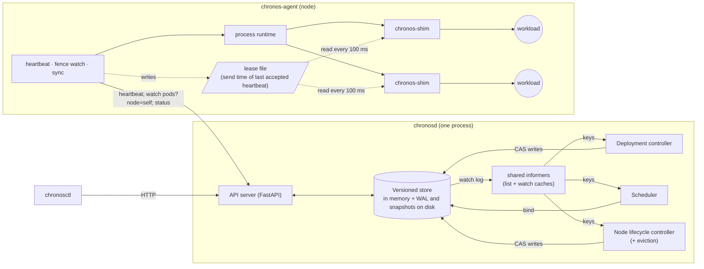

# Chronos

A small container orchestrator, in the spirit of Kubernetes, built from scratch in Python to
learn and demonstrate how orchestration works: declarative desired state, a versioned store
with compare-and-swap, a filter/score scheduler, node heartbeats and failure detection, and
level-triggered reconciliation. Workloads are real OS processes.

> You declare desired state in YAML. Chronos places each replica on a node that fits its CPU,
> memory and extended-resource requests (an extended resource such as `chronos.dev/slot` is an
> integer, non-shareable, **hard** constraint), runs it as a real OS process, and when a node
> dies it detects the failure and reschedules the work. It never places a workload on a node
> that doesn't advertise enough free units of a requested extended resource, even when that
> means the workload waits. Every one of those statements is backed by a property-based or
> real-process test.

**Status: `v0.1-mvp` + PM-1 (self-fencing) + PM-2 (durability) + PM-3 (watch and
informers) + PM-4 (deterministic simulation) + PM-5 (CLI, events, metrics and dashboards).** The core loop works end to end; workloads are fenced when their node loses
contact with the control plane, so a paused, crashed or partitioned node can't cause duplicate
replicas; every acknowledged write is on disk before it's acknowledged, so a `chronosd` crash
loses nothing; controllers and agents react to changes through watches instead of polling;
and a deterministic simulator runs the real store, controllers and agent through thousands of
seeded fault schedules, checking every safety invariant after every event. The
[limitations](#limitations-what-chronos-does-not-do-yet) are listed below, each with the block
that fixes it, plus the [design limitations](#design-limitations-deliberate) that stay.

## Quickstart

Needs [uv](https://docs.astral.sh/uv/) and macOS or Linux.

```bash
uv sync                      # Python 3.12 + dependencies from uv.lock
make check                   # ruff, mypy --strict, ~550 tests (unit, property, sim, real-process)
make demo-cluster            # chronosd on :7070 + agents plain-1, slot-a, slot-b
```

In a second terminal:

```bash
uv run chronosctl get nodes
uv run chronosctl apply -f examples/web.yaml
uv run chronosctl get pods -o wide
```

Dashboards (needs Docker): `make observability`, then open http://localhost:3000. Prometheus
scrapes `chronosd` and every agent once a second, and the provisioned Chronos dashboard shows
nodes by condition, pods by phase, reconcile and scheduling latency, queue depths, heartbeat
age per node, fencing events, allocated vs capacity per resource, and WAL fsync latency
([ADR-0024](docs/adr/0024-prometheus-grafana-observability.md)).

**`chronosctl`:**

| Command | What it does |
|---------|--------------|
| `apply -f FILE` | create or update (compare-and-swap, retried on conflict); a deployment's template change rolls out under its `max_surge` / `max_unavailable` |
| `get KIND [NAME] [-o table\|wide\|yaml\|json] [--watch]` | nodes, pods, deployments, events, or any registered kind |
| `describe KIND NAME` | the whole object, plus its events (e.g. why a pod is Pending) |
| `logs POD [--stderr]` | the workload's output (local mode: agents on this machine) |
| `scale deployment NAME --replicas N`, `delete KIND NAME` | |
| `cordon NODE`, `uncordon NODE` | stop or resume new placements on a node |
| `drain NODE` | cordon, then move every pod off (each is re-created elsewhere by its controller) |

Pods can have **readiness and liveness probes** (exec, HTTP GET or TCP, with thresholds): a pod
is ready, and counts for a rollout, only once its readiness probe passes; failing liveness
restarts it. A **memory limit** is enforced by polling resident memory every 0.5 s; a pod over
it is killed and ends `OOMKilled`.

Examples in [`examples/`](examples/): `hello` (one pod), `web`, `slot-demo`, `crashy`
(crash-loop back-off and its events), `big` (unschedulable, and `describe` says why).
`chronosd` and the agent take `--log-format json` for one JSON object per line, carrying
`component`, `node`, and each reconcile's `controller`, `key` and `trace_id`.

## Demo

`plain-1` has no slots; `slot-a` and `slot-b` advertise `chronos.dev/slot=1` each. Demo
timings: heartbeat 0.5 s, Unknown after 2 s of silence, NotReady (and eviction) after 5 s.

| Step | Run | What happens |
|------|-----|--------------|
| 1 | `chronosctl get nodes` | 3 nodes `Ready`; the slot column reads `—`, `0/1`, `0/1` |
| 2 | `chronosctl apply -f examples/web.yaml` | 3 `web` pods go Pending → Bound → Running, spread over the nodes, each with a real PID |
| 3 | `ps -A -o pid,pgid,command \| awk '$2 == <pid>'` | the pod's process group: its `chronos-shim` and the real workload under it |
| 4 | `chronosctl scale deployment web --replicas 5` | 2 more pods converge |
| 5 | `chronosctl apply -f examples/slot-demo.yaml` | 2 slot pods run on `slot-a` and `slot-b`; the 3rd stays Pending: `0/3 nodes available: Insufficient chronos.dev/slot (3/3 nodes)` |
| 6 | `chronosctl scale deployment slot-demo --replicas 2` | the Pending pod is the one removed |
| 7 | `scripts/kill-node.sh slot-a` | `slot-a` → Unknown → NotReady; its pods → `Failed/NodeLost`; `web` is replaced elsewhere; the slot pod's replacement **waits** instead of landing on `plain-1` |
| 8 | `scripts/start-agent.sh slot-a --resource chronos.dev/slot=1` | `slot-a` is Ready again and the waiting pod takes its slot |
| 9 | `chronosctl get events` | the story so far, one line per object and reason: Scheduled, Started, FailedScheduling, NodeNotReady, Evicted, ... |

With `make observability` running, watch step 7 on the dashboard: `slot-a`'s heartbeat age
climbs, it flips to NotReady 5 s later, `Failed` pods appear and then the replacements.

The same scenario runs as an automated test,
[`test_demo_scenario.py`](tests/integration/test_demo_scenario.py), and unattended against a
fresh copy of the repo with `scripts/fresh-clone-check.sh`.

## Architecture



- **One store holds the truth.** Every write bumps a global revision and is a compare-and-swap
  on the object's `resource_version`, so a stale writer gets `409 Conflict` instead of
  silently overwriting ([ADR-0007](docs/adr/0007-versioned-single-writer-store.md)).
- **Durable before acknowledged.** Each write is one CRC-framed record in a write-ahead log,
  synced to disk (`F_FULLFSYNC` on macOS) before memory changes and before the client hears
  back (or, with `--wal-sync group`, several writes share one sync and nothing is answered
  until it's done: about 10× the write throughput under concurrent load); snapshots bound
  recovery time. On restart a write torn by the crash is cut off, and
  any other damage stops the server from starting rather than silently losing data
  ([ADR-0015](docs/adr/0015-wal-and-snapshots.md)).
- **Functional core, imperative shell.** Scheduling, reconciliation, node health and agent
  sync are pure functions in `src/chronos/core/` with no I/O or clock access; the loops around
  them are thin ([ADR-0006](docs/adr/0006-functional-core-imperative-shell.md)). That is what
  makes the property tests below possible.
- **Level-triggered, on watches.** Changes reach controllers through a long-poll watch on the
  store's revision log; an informer keeps a local cache and turns each change into a *key*
  on a deduplicating work queue, and `reconcile(key)` recomputes the whole diff for that key.
  A client that fell too far behind gets `410 Gone` and relists: a watch never silently skips
  (S6). Caches lag, so the deployment controller tracks **expectations** (it won't create a
  pod twice before its cache has seen the first) and the scheduler keeps an **assume cache**
  (its own binds count before the cache shows them)
  ([ADR-0008](docs/adr/0008-watch-via-long-polling.md),
  [ADR-0009](docs/adr/0009-level-triggered-reconciliation.md)).
- **Agents pull.** The control plane never connects to an agent.
- **Self-fencing.** Every workload runs under a small `chronos-shim` that reads the agent's
  lease file. Once no heartbeat has been accepted for `fence_timeout` F (measured from the
  heartbeat's *send* time), the agent and every shim stop their workloads within the grace K,
  even if the agent itself is dead. The control plane only starts replacements after
  `eviction_timeout` E, and both sides refuse timings unless F + K + drift < E, so old and new
  never overlap ([ADR-0012](docs/adr/0012-agent-self-fencing.md)).

All of the MVP's shortcuts ([ADR-0022](docs/adr/0022-week-1-mvp-scope.md), now Deprecated)
have been replaced by the designs they stood in for.

## What is guaranteed, and how it's tested

| Invariant | Status | Evidence |
|-----------|--------|----------|
| **S1** a pod is bound to at most one node, once | ✅ | [store unit tests](tests/unit/test_store.py), [stateful model test](tests/property/test_store_model.py) |
| **S2** for every resource name, Σ requests ≤ capacity on every node | ✅ | [scheduler properties](tests/property/test_schedule_props.py), [bind property](tests/property/test_store_bind_props.py), [integration](tests/integration/test_scheduling.py) |
| **S3** at most R live processes per deployment | ✅ under agent pause, agent crash and network partition | integration, sampling live process groups every 20 ms: [paused agent, killed agent, partitioned node](tests/integration/test_fencing.py), [quick agent restart](tests/integration/test_orphans.py), [whole-node loss](tests/integration/test_deployments.py). A **whole-node freeze** has a bounded window of one shim poll ([test](tests/integration/test_fencing.py); design limitation 2). |
| **S4** a cut-off node's workloads stop within F + K | ✅ | [paused agent, partitioned node](tests/integration/test_fencing.py); [shim on real processes](tests/integration/test_shim.py); [fence boundaries](tests/unit/test_fencing.py); [send-time rule](tests/unit/test_agent_fencing.py) |
| **S5** revisions strictly increase; a stale compare-and-swap never succeeds | ✅ | [stateful model test](tests/property/test_store_model.py) |
| **S11** extended resources are a hard constraint, never a soft preference | ✅ | [scheduler properties](tests/property/test_schedule_props.py), [bind property](tests/property/test_store_bind_props.py), [integration](tests/integration/test_scheduling.py), [demo scenario](tests/integration/test_demo_scenario.py) |
| **L1** a dead node is detected within the configured windows | ✅ | [boundary table](tests/unit/test_node_health.py), [lifecycle on a fake clock](tests/unit/test_node_lifecycle.py), [integration](tests/integration/test_agent.py) |
| **L2** deployments converge to their replica count | ✅ | [reconcile properties](tests/property/test_reconcile_props.py), [integration](tests/integration/test_deployments.py) |
| **L3** a pending pod that fits somewhere gets placed | ✅ | [scheduler properties](tests/property/test_schedule_props.py), [demo scenario, step 8](tests/integration/test_demo_scenario.py) |
| **L5** no processes left behind after delete or teardown | ✅ | [integration](tests/integration/test_deployments.py); every integration test fails if a pod process outlives its cluster ([fixture](tests/integration/conftest.py)) |
| **S12** no unit of an extended resource is held by two live pods | ✅ | [provider property](tests/property/test_providers_props.py), [integration](tests/integration/test_scheduling.py) |
| **S8** an acknowledged write survives a control-plane crash; nothing half-written is applied | ✅ | [crash at 7 crash points x 50 seeds, recover, compare with a reference run](tests/durability/test_crash_recovery.py) (`make test-durability`); [recovery from every truncation offset, bit flips, disk full, restart equivalence](tests/property/test_wal_props.py) |
| **L4** the cluster reconverges after a control-plane restart | ✅ | [back within F: same PIDs; down longer: everything fenced, then the same pods restart on their nodes; crash mid scale-up: exactly 20 pods](tests/integration/test_control_plane_restart.py) |
| **S6** a watch from revision r delivers every change after r, in order, or fails with `410 Gone`; it never silently skips | ✅ | [replay from every revision of random histories, whole kind, node filter and small batches](tests/property/test_watch_props.py); [both clients, long-poll wake-up, compaction](tests/contract/test_store_client.py); [informer relists after 410 and after a restart](tests/unit/test_runtime.py) |
| **S7** during a rolling update, at most `replicas + max_surge` pods, and ready pods are never voluntarily taken below `replicas - max_unavailable` | ✅ | [rollout properties](tests/property/test_rollout_props.py), [real processes, sampled](tests/integration/test_tier2.py); the simulator and the chaos checker |

Every safety row above (S1-S8, S11, S12) is also checked by the [simulator](tests/sim/test_sim.py) after every event of every seed, and L1-L3 and L5 at the end of each run.

**Modularity:** a resource that exists only in test code, `example.com/widget`, with a
test-only scheduler plugin, workload type and resource provider
([`tests/extensions.py`](tests/extensions.py)), passes the scheduling and bind properties
([`test_modularity_widget.py`](tests/property/test_modularity_widget.py)), runs a real process
through the unchanged agent runtime ([`test_seams.py`](tests/integration/test_seams.py)), and
holds every invariant in the simulator under faults, where a deliberately broken test provider
is caught as S12 ([`test_seam_proof.py`](tests/sim/test_seam_proof.py)). A kind plus a
controller that exist only in test code get the HTTP API, watch, store validation, WAL
durability, manifest parsing and a reconcile loop, and the pods they own are left alone by the
deployment controller ([`test_kind_registry.py`](tests/integration/test_kind_registry.py)).
How each Stage 2 task plugs in: [docs/PHASE2-EXTENSION-POINTS.md](docs/PHASE2-EXTENSION-POINTS.md).

**How the tests are layered:** unit tests, Hypothesis property and stateful tests (100 examples
locally, 1 000 in CI, 20 000 with `make test-nightly`), a **deterministic simulator**, integration
tests that run a real `chronosd` and agents as subprocesses, and a durability harness that
crashes the store at every crash point and checks what recovery gives back. CI runs everything
on Ubuntu and macOS.

**The simulator** (`python -m chronos.sim --seed N`, [ADR-0016](docs/adr/0016-deterministic-simulation-testing.md)) runs the
*real* store (WAL and recovery included), controllers and agent under virtual time and one
seeded RNG. It injects node, agent and control-plane crashes, pauses, whole-node freezes,
partitions, delay spikes, drops, workload crash storms and failing probes, alongside template
updates (rolling updates mid-fault), and checks S1-S8, S11 and S12 after every event, then
L1-L3 and L5 once the run is quiet. Any failure replays exactly from
its seed and can be shrunk with `--minimize`. Eleven **canary bugs** (fencing off, expectations off,
no bind capacity check, F > E, ack before fsync, a rollout ignoring `max_unavailable`, ...) must each be detected; they are, within
the first six seeds. On its first runs it found three real bugs, now fixed and replayed on
every PR ([`tests/sim/regressions.txt`](tests/sim/regressions.txt)). CI: 200 seeds per PR,
10 000 nightly.

**Chaos on real processes** (`python -m chronos.testing.chaos --seed N --duration 600`): a real
`chronosd` and agents, each agent's link through a [fault proxy](src/chronos/testing/faultproxy.py)
(delay, drop, blackhole, reset), under a seeded schedule of kill -9 (agent, whole node,
`chronosd`), SIGSTOP of an agent or of a whole node, link faults, crash storms and failing
probes, with rolling updates mid-run. A live checker reads the store and the OS process table
every 200 ms (S1-S4, S7, S11, S12), then checks
liveness after the heal, and writes a report and a timeline. A planted rogue process proves
it can see a violation. CI: 60 s per PR, 3 x 10 min nightly.

**Benchmarks** (B1-B6: convergence, failure recovery, detection vs false positives, scheduler
throughput, WAL cost, recovery time) with methodology, raw samples and interpretation:
[docs/BENCHMARKS.md](docs/BENCHMARKS.md).

## Limitations: what Chronos does not do yet

> **What this does NOT do yet.** Each item names the planned fix. PM-1 closed the items
> about fencing, crash backoff and one-phase deletion; PM-2 closed durability; PM-3 closed
> polling; PM-5 closed metrics and dashboards; PM-6 closed chaos testing and benchmarks;
> PM-9a closed probes, rolling updates, memory limits and drain.

1. **No GPU/CUDA support: planned, Stage 2 (deferred).** Nothing detects or uses GPUs, and no CUDA runs. Stage 1 provides the seams GPU support plugs into: extended resources (X-1/X-2), workload types (X-4) and resource providers (X-5), proven in-process by PX.9 ([`test_modularity_widget.py`](tests/property/test_modularity_widget.py)).
2. **Little resource isolation.** Requests are used for placement accounting. Memory **limits** are enforced, but by polling resident memory every 0.5 s and killing the pod (OOMKilled), not by a cgroup: a fast allocation can overshoot for up to one interval. CPU stays advisory: a process can use more than it requested (ADR-0014).
3. **Single machine, single control plane.** Nodes are processes on one host; there's no control-plane HA. → Backlog (P11.x, ADR-0018); not scheduled.
4. **No jobs / run-to-completion workloads: planned, Stage 2 (deferred)** (ADR-0020). Only long-running Deployments. The kind and controller registries (X-6, built in PM-3) make Jobs purely additive.
5. **Scheduling policies are generic.** `LeastAllocated` (spread, default) or `MostAllocated` (pack), chosen with `chronosd --scheduler-policy`. Resource-aware stranding avoidance for GPUs (`GpuAvoidance`) is **planned, Stage 2 (deferred)**.
6. **No auth, TLS or multi-tenancy.** It's built for a trusted localhost. (Non-goal.)
7. **Extensions are in-process only.** There's no plugin loader; new kinds, controllers, resources, workload types and providers are registered by in-tree code. (Conscious limit, ADR-0023; a loader may be added at the start of Stage 2 if needed.)

## Design limitations (deliberate)

These stay true at the end of Stage 1; they are trade-offs, not missing work.

1. **A control-plane outage longer than `fence_timeout` stops every workload (fencing Option A).** Agents can't tell a dead control plane from a partition, so they fence. This trades availability for safety (no duplicates). Real Kubernetes keeps pods running while the API server is down; Chronos deliberately doesn't. When the control plane returns, startup grace prevents evictions and agents restart their still-bound pods (L4). A smarter fencing rule (e.g. peer checks) was rejected as too complex; the real fix is control-plane HA, which is in the Backlog (P11.x, ADR-0018). Tested by U2.2 (b) ([`test_long_outage_fences_everything_then_reconverges`](tests/integration/test_control_plane_restart.py)).
2. **"No duplicate replicas" (S3/S4) is scoped to agent pause, agent crash and network partition.** For a **whole-node freeze** (a VM pause that stops the shims too), there's a bounded window of **at most one shim poll (100 ms)** after the node resumes, during which a stale workload may run alongside its replacement before the shim (or the agent, whichever runs first) SIGKILLs it. The simulator found this bound broken once (the agent renewed its lease before the shim's poll); it holds now, and is checked after every event. Kubernetes has the same limit. The README must not claim "no duplicates under any pause".
3. **Fencing assumes the node's monotonic clock keeps advancing across a freeze.** That holds for Chronos's single-host setup (all "nodes" share the host clock). On real VMs it depends on the hypervisor's clock handling; if the guest clock stalled, the window in #2 could extend up to `fence_timeout`.

## Roadmap

The block names used above, in build order:

| Block | What it adds |
|-------|--------------|
| **PM-1** ✅ | Self-fencing (agent + per-pod shim), restart with backoff, orphan cleanup, two-phase deletion, workload-type and resource-provider seams |
| **PM-2** ✅ | Durability: write-ahead log with CRC framing, snapshots, crash-point-tested recovery |
| **PM-3** ✅ | Watch + informers + work queue + expectations + assume cache, replacing polling; kind and controller registries |
| **PM-4** ✅ | Deterministic simulation with canary bugs |
| **PM-5** ✅ | Full CLI, structured logs, events, `/metrics`, Prometheus + Grafana |
| **PM-6** ✅ | Chaos harness (partitions, pauses, delays) and benchmarks |
| **PM-9a** ✅ | Probes, rolling updates (S7), memory limits, drain |
| **PM-9b** ✅ | Seam proof: a test-only resource, plugin, workload type and provider through scheduling, bind, a real process and the simulator; the Stage 2 guide checked against the code |
| **PM-9c** | Final write-up |
| Stage 2 | GPU-aware scheduling and CUDA workloads, on the seams above (deferred) |

## Layout

```
src/chronos/
  api/          Pydantic models, the resource map and quantity parsing
  core/         pure logic: schedule, reconcile, node_health, agent_sync
  store/        versioned store, WAL + snapshots + recovery, watch log, kind registry,
                validation, heartbeat leases
  server/       FastAPI app and the chronosd entry point
  controllers/  runtime (informers, work queue, expectations, registry), deployment,
                scheduler, node lifecycle
  client/       StoreClient protocol, local and HTTP clients
  agent/        chronos-agent, the process runtime, resource providers
  shim/         chronos-shim: per-pod wrapper that enforces fencing
  sim/          deterministic simulator: engine, network, disk, faults, invariants, canaries
  cli/          chronosctl
  testing/      test workload, real-cluster fixture, kill_node()
deploy/         Prometheus + Grafana (docker compose, provisioning, the dashboard)
examples/       manifests for the demo
docs/adr/       architecture decision records
docs/devlog/    what was built each day, and what broke
```
