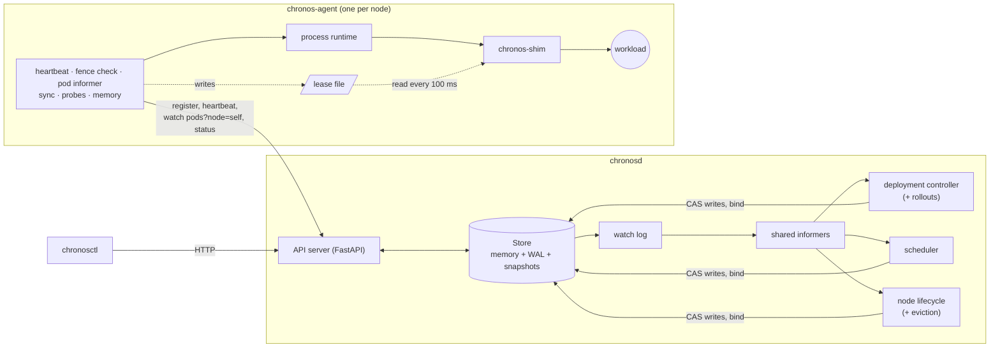
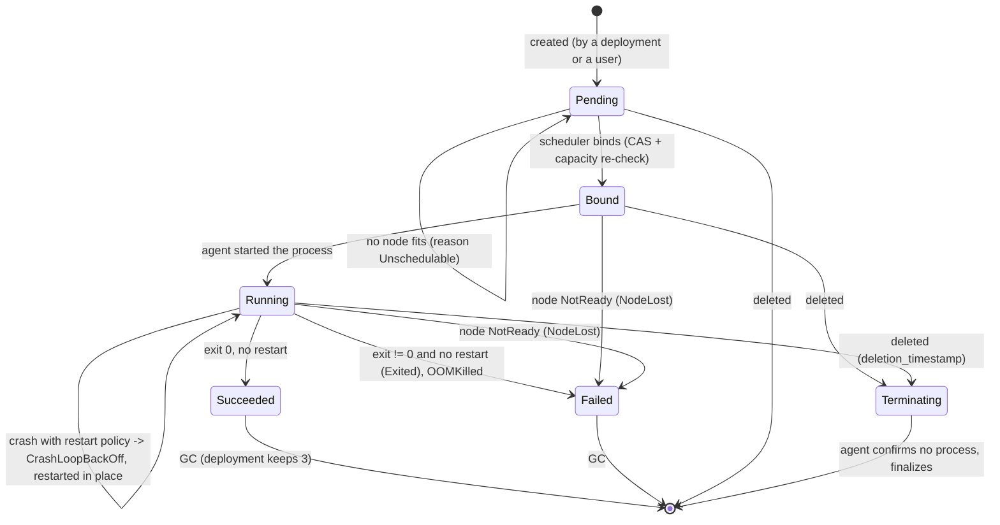
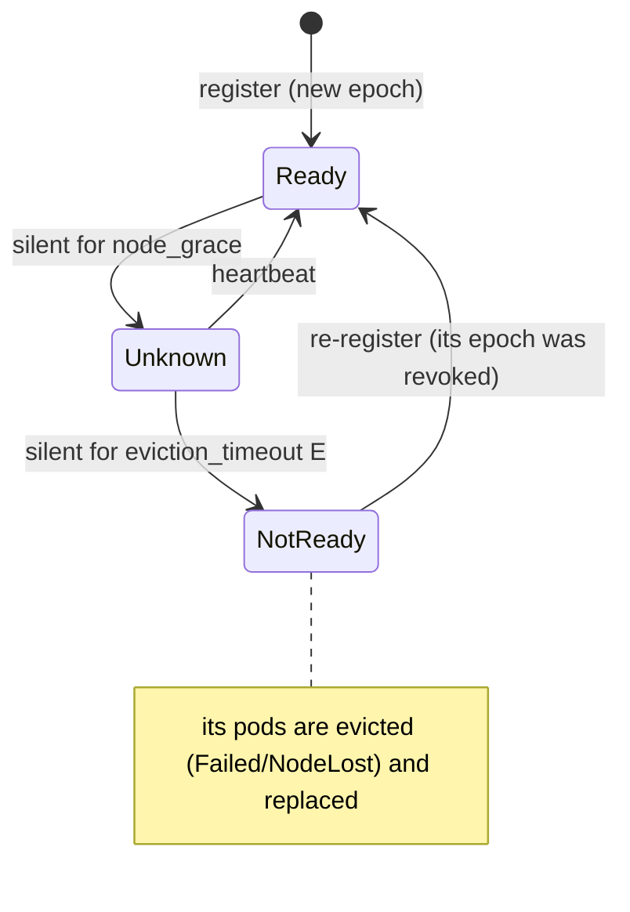
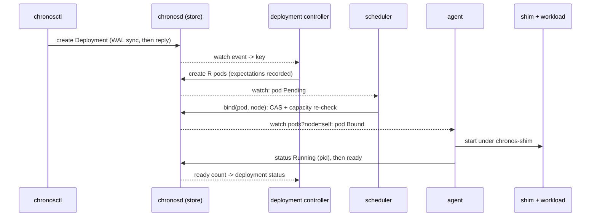
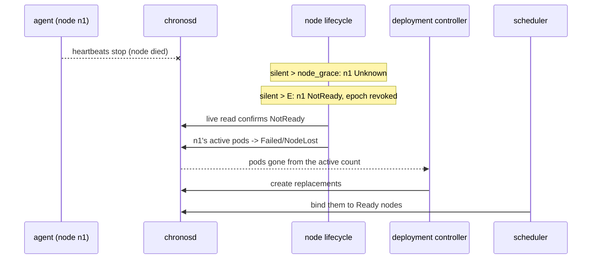
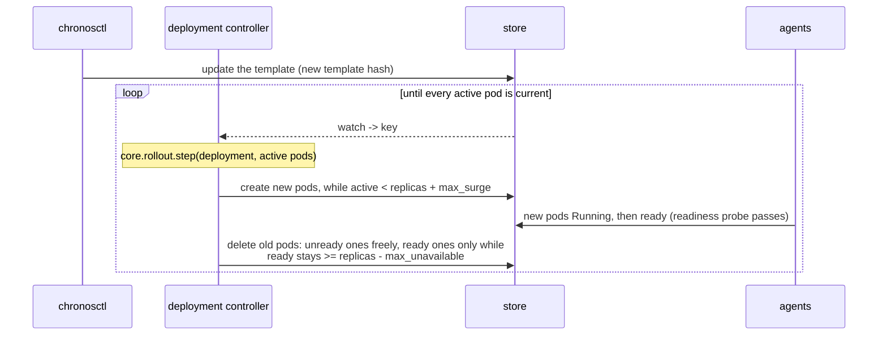

# Architecture

How Chronos's pieces fit together: the processes, the object model, the two state machines, and the paths a change takes through the system. The *why* behind each design is in the [ADRs](adr/README.md); this document links to them rather than repeating them.

## 1. Processes

| Process | Count | What it does |
|---|---|---|
| `chronosd` | 1 | The API server, the store (in memory, with a WAL and snapshots on disk), and every controller: deployment (including rollouts), scheduler, node lifecycle, event GC. |
| `chronos-agent` | 1 per node | Registers its node, heartbeats, watches the pods bound to it, runs them as processes, probes them, reports their status. |
| `chronos-shim` | 1 per running pod | Starts the workload in its own process group and stops it when the node's lease goes stale, even if the agent is dead. |
| `chronosctl` | on demand | The CLI: `apply`, `get`, `describe`, `logs`, `scale`, `delete`, `cordon`, `drain`. |

Nothing ever connects *to* an agent: agents pull ([ADR-0010](adr/0010-pull-based-agents.md)). All "nodes" in this project are processes on one host.



## 2. Code map

The code is a **functional core with an imperative shell** ([ADR-0006](adr/0006-functional-core-imperative-shell.md)): every decision is a pure function in `core/`, with no I/O, asyncio, clocks or randomness (an [architecture test](../tests/unit/test_architecture.py) enforces it), and the loops around those functions are thin. The same functions run under real time, under Hypothesis, and under the simulator's virtual time.

| Package | Role | Pure? |
|---|---|---|
| `api/` | Pydantic models, quantities, the resource map, the workload-type registry | yes |
| `core/` | `schedule`, `reconcile`, `rollout`, `probes`, `node_health`, `fencing`, `agent_sync` | yes |
| `store/` | versioned store, bind transaction, WAL + snapshots + recovery, watch log, kind registry, leases | I/O at the edges |
| `controllers/` | the controller runtime (informers, work queue, expectations, registry) and the controllers | shell |
| `server/` | the FastAPI app and the `chronosd` entry point | shell |
| `client/` | the `StoreClient` protocol, with in-process and HTTP implementations, and the event recorder | shell |
| `agent/` | `chronos-agent`: the agent loops, the process runtime, probes, resource providers | shell |
| `shim/` | `chronos-shim`, standard library only | shell |
| `cli/` | `chronosctl` | shell |
| `sim/` | the deterministic simulator: it drives the real store, controllers and agent | test harness |
| `testing/` | the test workload, the real-cluster fixture, the fault proxy, the chaos harness | test harness |

## 3. Object model

Every object has `metadata`, `spec` (desired state, written by users and controllers) and `status` (observed state, written through a separate status endpoint by whoever observes it).

| Field (`metadata`) | Meaning |
|---|---|
| `name` | unique per kind, DNS-label-like |
| `uid` | unique per incarnation: a pod deleted and re-created under the same name is a new object |
| `resource_version` | the store revision of the object's last write; every update is a compare-and-swap on it |
| `generation` | bumped on spec changes only |
| `owner` | the uid of the owning object (a Deployment, for its pods) |
| `labels` | free-form; pods made by a deployment carry `chronos.dev/deployment` |
| `deletion_timestamp` | set by a delete; the object stays until whoever runs it confirms it stopped (two-phase deletion) |

| Kind | Spec | Status (written by) |
|---|---|---|
| **Node** | capacity (a resource map), `unschedulable` | condition, last heartbeat (`chronosd`, from the agent's register and heartbeats) |
| **Pod** | template fields (command, env, resources, restart policy, probes, workload type), `node_name`, `template_hash` | phase, reason, message, pid, exit code, restart count, ready, assigned units (the agent; the scheduler's bind sets `node_name` and Bound) |
| **Deployment** | replicas, template, strategy (`max_surge`, `max_unavailable`) | replicas, ready, up-to-date (deployment controller) |
| **Event** | object, reason, message, count, first and last seen | (append-only, recorded by any component) |

**Resources** are a map of name to integer: `cpu` in millicores, `memory` in bytes, and any other name is an extended resource in whole units, which is a hard constraint: a node that doesn't advertise it has 0 ([ADR-0014](adr/0014-resource-model.md)). New kinds register through the kind registry and get the API, watch, validation and WAL with no other changes ([ADR-0023](adr/0023-extension-seams.md), X-6).

## 4. The store

One global, monotonically increasing **revision**; every write bumps it and stamps the object's `resource_version`. Updates are compare-and-swap, so a stale writer gets `409 Conflict` ([ADR-0007](adr/0007-versioned-single-writer-store.md)). **Bind** is a transaction: the pod must still be unbound at the expected version, and the node must have room for every requested resource, re-checked here whatever the scheduler thought (S1, S2, S11).

**Durability** ([ADR-0015](adr/0015-wal-and-snapshots.md)): each write is one CRC-framed WAL record, synced (`F_FULLFSYNC` on macOS) before memory changes and before the reply. With `--wal-sync group`, concurrent writes share one sync, and nothing is answered or visible to readers until it completes. Snapshots bound recovery: `Store.open` loads the newest valid snapshot and replays the log after it. A torn tail (the crash's last, half-written record) is cut off; any other damage stops startup.

**Watch** ([ADR-0008](adr/0008-watch-via-long-polling.md)): the watch log keeps recent events after a `floor` revision. A watch from revision *r* gets every change after *r* in order, or `410 Compacted` if *r* is older than the floor; the client then relists. After a restart the log is empty and the floor is the recovered revision, so every watcher relists.

## 5. Control loops

Controllers are level-triggered ([ADR-0009](adr/0009-level-triggered-reconciliation.md)). A **shared informer** per kind lists, then watches, keeping a local cache. Each change becomes a **key** on a deduplicating **work queue**, and `reconcile(key)` recomputes the whole difference between desired and observed state for that key from the cache. Every key is also re-queued periodically (resync), so a missed event delays a fix but never loses it.

Caches lag the store, and two mechanisms make that safe:

*   **Expectations** (deployment controller): before creating or deleting pods it records what it expects to see; until the cache has caught up, it does nothing for that key. Without them it creates pods twice (the `disable_expectations` canary).
*   **The assume cache** (scheduler): its own binds count against a node's free capacity before the cache shows them. The store's bind re-check is the backstop.

| Controller | Key | Does |
|---|---|---|
| deployment | deployment uid | creates and deletes pods (`core.reconcile`), runs rolling updates (`core.rollout`), garbage-collects its orphaned and finished pods, writes status |
| scheduler | pod name | filters and scores nodes (`core.schedule`), binds; records `FailedScheduling` with the reasons |
| node lifecycle | node name | computes the condition from heartbeat silence (`core.node_health`), every `lifecycle_tick`; evicts pods from NotReady nodes after a live read confirms the condition |
| event GC | event name | deletes events not seen for an hour |

## 6. The agent and the shim

The agent runs these loops on one asyncio event loop, all driven by `core/` decisions:

| Loop | Period | Does |
|---|---|---|
| heartbeat | `heartbeat_interval` | renews the lease; on success records the request's **send** time as `last_ok_send` and writes it to the lease file |
| fence check | `min(interval, shim_poll)` | `core.fencing`: past F since `last_ok_send`, stop every workload and start nothing |
| pod informer | watch | the pods bound to this node |
| sync | on change, plus resync | `core.agent_sync.plan`: start, restart with back-off, stop, report status, finalize deletions |
| probes | 100 ms | runs due readiness and liveness probes (`core.probes`); a readiness change wakes the sync |
| memory | 500 ms | kills a pod whose process tree's RSS exceeds its memory limit (`OOMKilled`) |

On start it first kills process groups left by a previous incarnation, then registers under a new **epoch**, and acts only once its pod cache has caught up to its registration. Each workload runs under `chronos-shim` in its own process group. The shim reads the lease file every 100 ms and applies the same fencing rule as the agent, so a paused or dead agent can't leave workloads running: past F it stops the workload with SIGTERM, then SIGKILL after K; past E (it was frozen) it SIGKILLs at once ([ADR-0012](adr/0012-agent-self-fencing.md)).

## 7. State machines

### Pod



`ready` is separate from the phase: a Running pod is ready once its readiness probe passes (immediately if it has none), and only ready pods count as available to a rollout. Terminating isn't a phase; it's a pod with `deletion_timestamp` set.

### Node condition



After `chronosd` starts, every node's last heartbeat is set to "now" (startup grace), so no node can go NotReady before E has passed.

## 8. Sequences

### `apply` to Running



### Node failure to replacement



B2 measures this at 5.29 s (p50) with the demo's timings, of which 5.0 s is E ([BENCHMARKS.md](BENCHMARKS.md)).

### Partition, self-fence, eviction, heal

```mermaid
sequenceDiagram
    participant W as shim + workload (n1)
    participant A as agent (n1)
    participant S as chronosd
    A->>S: heartbeat sent at t0, accepted
    A->>W: lease file = t0
    Note over A,S: partition at ~t0
    Note over A,W: t0 + F: agent and shim both see a stale lease
    A->>W: SIGTERM (agent), or the shim on its own
    Note over W: by t0 + F + K: workload gone (SIGKILL after K)
    Note over S: t0 + E: n1 NotReady, pods evicted, replacements start
    Note over A,S: Safe because F + K + drift < E: old copies are dead before new ones start
    Note over A,S: heal
    A->>S: heartbeat -> rejected (epoch revoked) -> re-register, new epoch
    S-->>A: watch: its old pods are Failed; nothing to run
```

The lease counts from the heartbeat's **send** time, never the reply's arrival: a reply that arrives late is still evidence the server heard the node *at send time*, and counting from the reply would let a slow network stretch the lease past E (the `measure_fence_from_ack_time` canary). Production defaults: F = 6 s, K = 2 s, drift = 1 s, E = 10 s; both `chronosd` and the agent refuse to start if F + K + drift ≥ E.

### Control-plane crash and recovery

```mermaid
sequenceDiagram
    participant A as agents
    participant S as chronosd
    participant WAL as WAL + snapshot
    Note over S: kill -9
    A--xS: heartbeats fail; leases age
    alt back within F
        S->>WAL: load snapshot, replay log, cut a torn tail
        Note over S: startup grace: every node's last heartbeat = now
        A->>S: heartbeat accepted: workloads never stopped (same PIDs)
        A->>S: watch from the old revision -> 410 Compacted
        A->>S: relist pods, continue
    else down longer than F
        Note over A: every agent fences: all workloads stop
        S->>WAL: recover as above
        A->>S: heartbeat -> leave Fenced, relist
        A->>A: restart the pods still bound to the node (new PIDs)
    end
    Note over S: the cluster reconverges (L4)
```

### Rolling update



A template that never becomes ready stalls the rollout with the old pods still serving. A rollout on a full cluster can also stall: the new pods can't be placed, and the old ones are at the floor. Kubernetes stalls in both cases too.

## 9. Where each guarantee is enforced

| Invariant | Enforced by | Checked by |
|---|---|---|
| S1 bound once | `Store.bind` (CAS, unbound check) | store tests, stateful model, simulator |
| S2/S11 capacity | `core.schedule` filter + the assume cache; `Store.bind` re-check | properties, simulator, chaos |
| S3/S4 no duplicates | agent and shim fencing; F + K + drift < E; kill past E before renewing the lease | integration (20 ms sampling), simulator, chaos |
| S5 revisions, CAS | the store | stateful model |
| S6 watch completeness | watch log `floor` + `410`; informer relist | replay properties, simulator |
| S7 rollouts | `core.rollout.step` | properties, real processes, simulator, chaos |
| S8 durability | WAL sync before apply and reply | crash points, WAL properties, simulator's disk |
| S12 unit exclusivity | resource providers (`agent/providers.py`) | provider property, simulator, chaos |

The full evidence table is in the [README](../README.md#what-is-guaranteed-and-how-its-tested); how strong each test is, in [testing-the-tests.md](testing-the-tests.md).

## 10. Extension seams

Each seam is a protocol plus a module-level registry ([ADR-0023](adr/0023-extension-seams.md)); there is no plugin loader.

| Seam | Where | Registers |
|---|---|---|
| X-1, X-2 resource map, extended-resource rule | `api/resources.py`, `api/quantity.py` | nothing: any name works |
| X-3 scheduler plugins | `core/schedule.py` | `register_filter`, `register_score` |
| X-4 workload types | `api/workload_types.py` | `register_workload_type` (validate, prepare) |
| X-5 resource providers | `agent/providers.py` | `register_provider` (allocate, release, env) |
| X-6 kinds and controllers | `store/kinds.py`, `controllers/runtime.py` | `register_kind`, `register_controller` |
| X-7 generic invariants | properties, simulator and chaos generators | resource names are made up per run |
| X-8 optional dependencies | [`test_architecture.py`](../tests/unit/test_architecture.py) | nothing yet: the test keeps Stage 1's code free of the GPU toolchain (numba, numpy), which Stage 2 adds as an optional group |

Test-only extensions in [`tests/extensions.py`](../tests/extensions.py) prove them end to end (PX.9).
