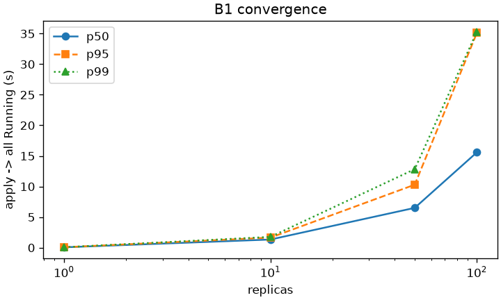
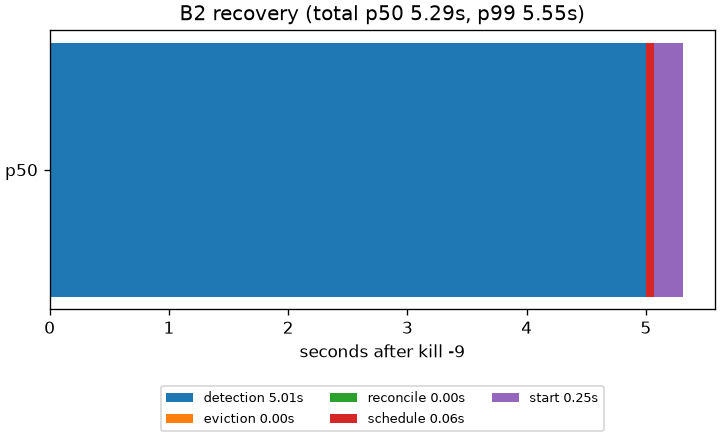
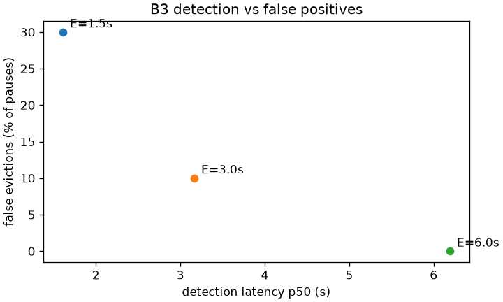
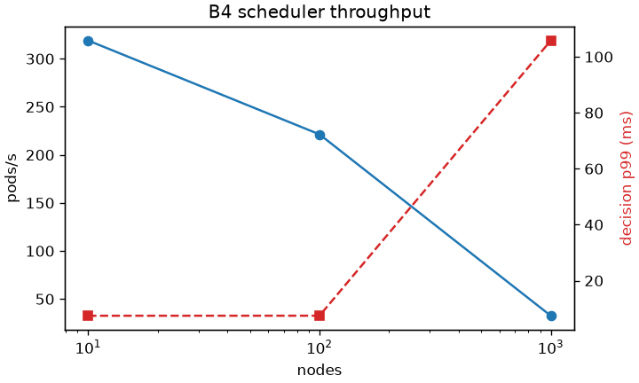
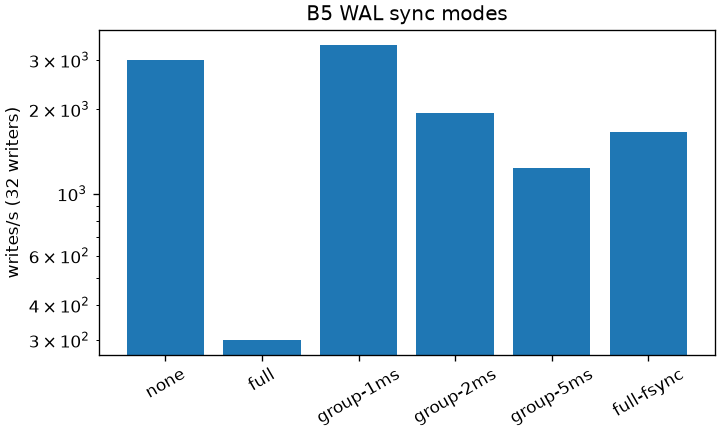
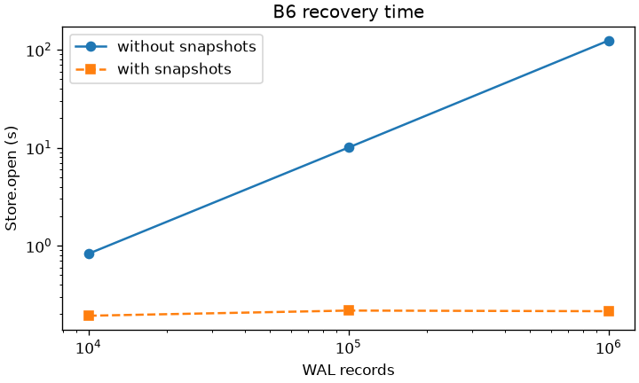

# Benchmarks

Six questions about how Chronos behaves, each answered with raw samples and percentiles,
never a single mean (TESTING.md §9). Results here are from **one machine** and are an
indication of shape and scale, not a product claim.

**Machine:** Apple M2, 8 cores, 16 GiB, macOS 26 (Darwin 25.5), Python 3.12.11, with ordinary
background activity (macOS's indexing services were busy during some runs; the load average
at the start of each benchmark is in its run log).

**Reproduce:** `make bench` (all six, about an hour), or one at a time, e.g.
`cd bench && uv run python b4_scheduler.py`; then `uv run python plot.py` for the plots.
Raw samples: [`bench/results/`](../bench/results/). Prometheus metrics are **not** used for
any number here: they're bucketed and scrape-sampled (ADR-0024).

| | Question | Headline |
|---|---|---|
| B1 | How long from `apply` to all replicas Running? | 1 replica: **53 ms** p50; 10: 1.3 s; 100: 15.6 s (p95 35 s) |
| B2 | From node death to replacements Running, and where does the time go? | p50 **5.29 s**, of which 5.0 s is detection by design |
| B3 | Detection speed vs false evictions | E = 3 s: detected in **3.2 s**, **10 %** of pauses falsely evicted; E = 6 s: 6.2 s, 0 % |
| B4 | Scheduler throughput vs cluster size | **221 pods/s** at 100 nodes (decision p50 3.6 ms); 33 pods/s at 1 000 |
| B5 | What does the WAL cost? | durable sync: **300 writes/s** (p50 3.0 ms); group commit: **3 393/s** |
| B6 | Recovery time vs WAL size | 1M records: **124 s** without snapshots, **0.22 s** with |

---

## B1: convergence latency

**Method:** a real `chronosd` and 3 agents (test-fixture timings: heartbeat 0.2 s). Each run
applies a deployment of R `sleep` pods and polls the API every 10 ms until all R are Running
(the agent's report after the process started: controller → scheduler → agent → process →
status), then deletes it and waits until every pod is gone. 30 runs per R.

| replicas | p50 | p95 | p99 | max | n |
|---|---|---|---|---|---|
| 1 | 0.053 s | 0.062 s | 0.064 s | 0.06 s | 30 |
| 10 | 1.33 s | 1.64 s | 1.76 s | 1.76 s | 30 |
| 50 | 6.50 s | 10.30 s | 12.83 s | 12.83 s | 30 |
| 100 | 15.58 s | 35.12 s | 35.30 s | 35.30 s | 30 |

**Interpretation:** a single replica goes from `apply` to a Running, reported process in
**53 ms**, through every component. From there the cost grows at roughly 130-160 ms per pod,
with a widening tail. The likely cause (an interpretation, not separately measured): every
pod is a Python `chronos-shim` plus its workload, all started on the same 8 cores that run
`chronosd` and the three agents, and every pod also costs about five fsynced store writes
(create, bind, two events, the Running report) at ~3 ms each on the server's single event
loop (B5). At R = 100 the machine is saturated by 100 interpreters starting at once, which is
what the p95 of 35 s shows. On real hardware with one node per machine, process starts would
run in parallel across machines; the control-plane share (the writes) is what would remain.

## B2: failure recovery, broken down

**Method:** demo timings (heartbeat 0.5 s, NotReady and eviction after E = 5 s, fencing after
2 s). A deployment of 6 `sleep` pods on 3 nodes; each run kill -9s the node with the most pods
and polls every 20 ms. 20 runs.

| phase | p50 | p95 | p99 |
|---|---|---|---|
| detection (kill → NotReady) | 5.005 s | 5.147 s | 5.212 s |
| eviction (→ its pods Failed) | 0.000 s | 0.000 s | 0.000 s |
| reconcile (→ replacements created) | 0.000 s | 0.061 s | 0.074 s |
| schedule (→ bound) | 0.064 s | 0.094 s | 0.115 s |
| start (→ Running) | 0.245 s | 0.329 s | 0.473 s |
| **total** | **5.286 s** | **5.419 s** | **5.551 s** |

**Interpretation:** recovery time *is* the eviction timeout. Everything after detection takes
about 0.3 s, mostly starting a process (a Python shim). Eviction shows 0 because the
lifecycle controller marks the pods Failed in the same pass that marks the node NotReady, and
the deployment controller usually creates replacements before the next 20 ms poll. So to
recover faster, lower E. But E is bounded below by F + K + drift (the fencing inequality,
ADR-0012) and by how many false evictions you'll accept, which is exactly what B3 measures.

## B3: detection speed vs false evictions

**Method:** one node; for each eviction timeout E (other timings scaled with it, keeping
F + K + drift < E): 3 kill -9s to measure detection, and 20 SIGSTOP pauses of the agent drawn
from one fixed, seeded distribution (lognormal, median 1 s, capped at 10 s: GC pauses, a
stalled VM). A pause counts as a **false eviction** if the node was declared NotReady
although its agent came back.

| eviction timeout E | detection p50 (n = 3) | max | false evictions (of 20 pauses) |
|---|---|---|---|
| 1.5 s | 1.61 s | 1.71 s | 6 (30 %) |
| 3 s | 3.16 s | 3.25 s | 2 (10 %) |
| 6 s | 6.19 s | 6.20 s | 0 |

The 20 pauses (seconds): 0.45, 0.64, 1.20, 0.65, 2.42, 1.25, 4.07, 1.13, 1.29, 2.38, 0.76,
2.59, 0.49, 0.31, 0.53, 3.11, 1.28, 1.02, 0.61, 3.34.

**Interpretation:** this is the real tradeoff behind E. Detection is E plus less than one
lifecycle tick (250 ms), every time. A pause causes a false eviction essentially when it lasts
longer than E: with E = 1.5 s, the 6 pauses longer than that were all evicted; with E = 3 s,
2 of the 3 longer than 3 s were (the third, 3.11 s, ended just inside E plus the tick). Each
false eviction is expensive here: the node's pods are replaced elsewhere, and its fenced
workloads must restart when it comes back. So choosing E means choosing the pause length
you're willing to mistake for death. Production's E = 10 s tolerates any pause in this
distribution and still detects a dead node in about 10 s (B2: recovery ≈ E + 0.3 s).

## B4: scheduler throughput vs cluster size

**Method:** in-process, no real processes: a real store with N Ready nodes and 5 000 pending
pods, and the real `SchedulerController` placing them one at a time (filters, scores, assume
cache, the store's bind transaction). The in-process watch delivers each bind before the next
decision, as in `chronosd`. A decision is one reconcile: decide and bind.

| nodes | pods/s | decision p50 | p95 | p99 | n |
|---|---|---|---|---|---|
| 10 | 319 | 2.27 ms | 4.49 ms | 7.44 ms | 5 000 |
| 100 | 221 | 3.56 ms | 4.81 ms | 7.46 ms | 5 000 |
| 1 000 | 33 | 26.80 ms | 36.54 ms | 105.81 ms | 5 000 |

**Interpretation:** a decision is linear in the number of nodes: every node is filtered and
scored for every pod (Kubernetes caps this with `percentageOfNodesToScore`, scoring a
sample of feasible nodes; Chronos doesn't yet). The first run of this benchmark found that
**85% of the time was deep-copying every cached Node on every decision**; a read-only
`Informer.view()` for that hot path made it **2.8× (10 nodes) to 3.9× (100 nodes) faster**
(115 → 319 and 57 → 221 pods/s). At 100 nodes, ~220 pods/s is far more than the convergence
paths in B1 and B2 need. At 1 000 nodes the next step would be node sampling.

CI runs a smoke version (100 nodes, 1 000 pods) and warns on a > 30 % drop from the committed
baseline; the baseline is from this laptop, so the job stays advisory until a CI-measured
baseline is committed.

## B5: what the WAL costs

**Method:** concurrent writers each create 50 pods through `LocalStoreClient` over a store
with a WAL; 3 repeats per mode; per-write ack latency.

| mode | 1 writer: writes/s | p50 | p99 | 32 writers: writes/s | p50 | p99 |
|---|---|---|---|---|---|---|
| `none` (no sync: the ceiling, never safe) | 2 603 | 0.36 ms | 0.66 ms | 2 999 | 0.34 ms | 0.59 ms |
| `full` (`F_FULLFSYNC` per write, the default) | 347 | 3.00 ms | 5.01 ms | 300 | 3.04 ms | 6.41 ms |
| `full-fsync` (plain `fsync(2)` on macOS) | 3 245 | 0.30 ms | 0.83 ms | 1 662 | 0.55 ms | 1.31 ms |
| `group-1ms` | 218 | 4.97 ms | 5.84 ms | **3 393** | 9.39 ms | 15.79 ms |
| `group-2ms` | 173 | 5.99 ms | 9.19 ms | 1 941 | 15.71 ms | 54.09 ms |
| `group-5ms` | 102 | 9.97 ms | 12.27 ms | 1 235 | 24.57 ms | 44.60 ms |

**Interpretation:**
- A durable sync on this Mac costs ~3 ms, so one-sync-per-write caps out near 300 writes/s
  however many writers there are.
- **macOS's plain `fsync` is nearly free** (as fast as no sync) because it only reaches the
  drive's cache, not stable storage. That's why the WAL uses `F_FULLFSYNC`: the 10× cost is
  the real price of durability on this platform.
- **Group commit** shares one sync among concurrent writers: with 32 writers and a 1 ms
  window it reaches the no-sync ceiling (~3 400/s; the two are within noise, both CPU-bound).
  With one writer there's nothing to share, so the window is pure added latency, which is
  why `full` stays the default. Longer windows are worse here: the best window is about one
  sync time.
- Full sync **blocks `chronosd`'s event loop** for each fsync. Under heavy write load that
  delays everything else, heartbeats included. Chaos found the consequence (see the devlog,
  PM-6); moving the sync off the event loop is the fix to make if write rates grow.

## B6: recovery time vs WAL size

**Method:** 1 000 pods, then label updates to them until the WAL holds N records (so the log
grows while the state stays small, as in real use); then `Store.open`, the real recovery, is
timed 3 times. "With" snapshots every 5 000 records (the default); "without" never.

| records | without snapshots | (on disk) | with snapshots | (on disk) |
|---|---|---|---|---|
| 10 000 | 0.83 s | 5.5 MiB | 0.19 s | 3.8 MiB |
| 100 000 | 10.04 s | 55.8 MiB | 0.22 s | 3.8 MiB |
| 1 000 000 | **124.07 s** | 561.4 MiB | **0.22 s** | 3.8 MiB |

**Interpretation:** without snapshots, recovery is linear in the log: about 124 µs per record,
almost all of it validating each record into a model. With them it's bounded by the state
plus at most 5 000 records, so it's flat. Old segments are deleted after each snapshot, so the
disk stays flat too. A control-plane restart after a long uptime takes a fraction of a second.

---

## Limits of these numbers

- One laptop, one run of each benchmark; the M2's efficiency cores and background activity
  add noise (the run logs record the load average). Shapes and orders of magnitude are the
  point, not the third digit.
- All nodes are processes on one host: there is no network latency between them, and every
  "node" shares the same CPU and disk.
- Timings in B1 and B3 are the test fixture's or scaled from it, much faster than production
  defaults (heartbeat 1 s, E = 10 s); B2 uses the demo's.
